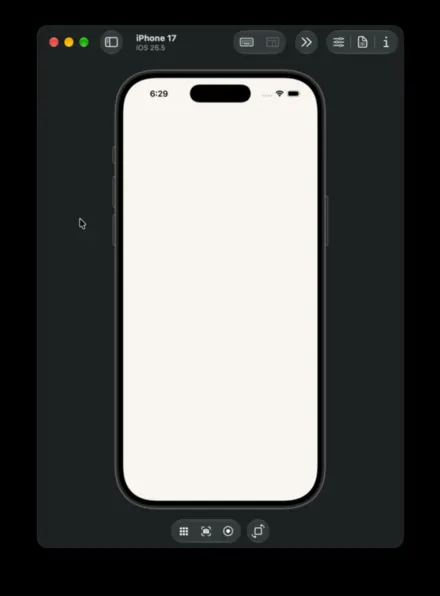

# Crave — Food Delivery UI

A minimalist Flutter food delivery experience designed around a strict three-color palette (**Warm Ivory**, **Deep Espresso**, and **Terracotta Ember**), paired with `Plus Jakarta Sans` typography, `CupertinoIcons`, cached image shimmers, and a street-locked vector delivery map.

## Demo



## Highlights

- **Editorial Launch & Three-Color System** (`SplashScreen`, `AppTheme`, `FoodColors`): Animated brand reveal using a transparent custom mark (`assets/images/crave_logo.png`) and unified surface, ink, and accent tokens across light-mode screens.
- **Discovery & Auto-Sliding Kitchens** (`FoodDiscoveryScreen`, `RestaurantCard`, `FoodMenuCard`): Location pill header, empty-by-default bag counter badge, cached Unsplash photography with warm shimmer placeholders (`FoodNetworkImage`), and an isolated carousel (`_FeaturedRestaurantsSlider`) that advances every `1400ms`.
- **Checkout Flow** (`OrderConfirmationScreen`, `QuantityStepper`): Door-handoff toggle (`Leave at door` / `Meet at door`), quantity controls, selectable extras, promo toggle (`CRAVE150`), and itemized summary with tabular numerals.
- **Street-Locked Live Courier Tracking** (`DeliveryTrackingScreen`, `DeliveryMapPainter`, `DeliveryScooterMarker`, `DeliveryStatusSheet`): Custom-painted neighborhood street grid where the top-down motorcycle waits with a pulsing beacon during preparation, rotates along exact centerline tangents (`PathMetric`) once picked up, and triggers a top arrival notification banner upon delivery.

## Project Structure

```text
lib/
├── main.dart
├── theme/app_theme.dart
├── models/food_item.dart
├── data/demo_food_data.dart
├── screens/
│   ├── splash_screen.dart
│   ├── food_discovery_screen.dart
│   ├── order_confirmation_screen.dart
│   └── delivery_tracking_screen.dart
└── widgets/
    ├── delivery_map_painter.dart
    ├── delivery_scooter_marker.dart
    ├── delivery_status_sheet.dart
    ├── food_menu_card.dart
    ├── food_network_image.dart
    ├── quantity_stepper.dart
    ├── restaurant_card.dart
    ├── section_header.dart
    └── sticky_order_bar.dart
```

## Quick Start

```bash
flutter pub get
flutter run
```
