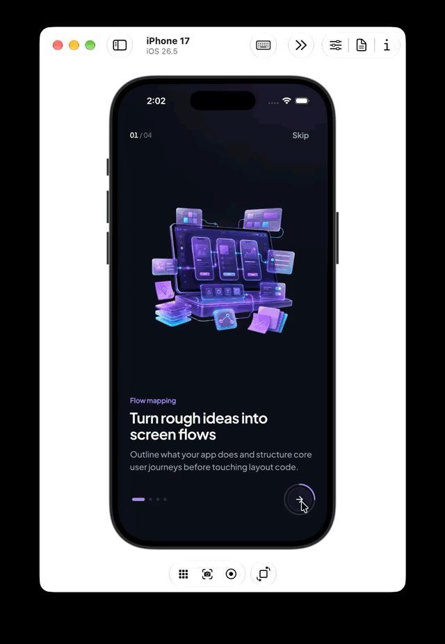

# Onboarding UI

A dark-mode Flutter onboarding flow built with scroll-driven `PageView` parallax, swipe-tracked studio rim lighting, a vertical-rolling step odometer, and a morphing radial progress CTA.

## Demo



## Highlights

- **Scroll-Driven Choreography**: Continuous `PageView` depth parallax, subtle 3D Y-tilt on hero renders, and live `SlidePalette.lerp` background interpolation (`OnboardingScreen`, `OnboardingSlideView`).
- **Studio Rim Lighting & Odometer**: Swipe-tracked top-edge radial wash (`StudioRimLight`) paired with a clipped vertical-rolling tabular step counter (`OnboardingTopBar`).
- **Morphing Progress Action**: Custom-painted radial progress ring (`ProgressNextButton`) that expands smoothly into the final `Start building` pill and opens `OnboardingCompleteSheet`.

## Quick Start

```bash
flutter pub get
flutter run
```
