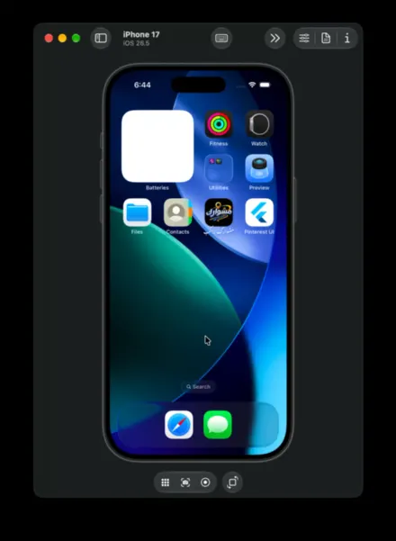

# Pinterest UI Clone

A clean, responsive Flutter recreation of the Pinterest mobile interface built around faithful light-mode design tokens, staggered two-column masonry layouts, and fluid motion transitions.

## Demo



## Highlights

- **Masonry Feed**: Asymmetric two-column pin wall with pull-to-refresh shuffling, shimmer startup skeletons, and staggered reveal animations.
- **Pin Details**: Smooth Hero image transitions into a full pin viewer with creator attribution and related pin recommendations.
- **Full Navigation**: Custom vector icons across Home, visual Search discovery, Create sheets, Updates, and Profile boards.

## Quick Start

```bash
flutter pub get
flutter run
```
