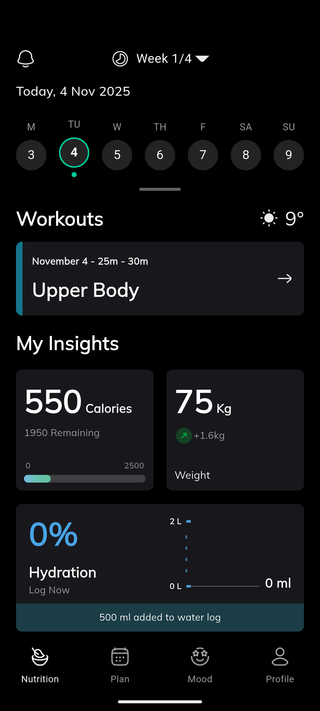
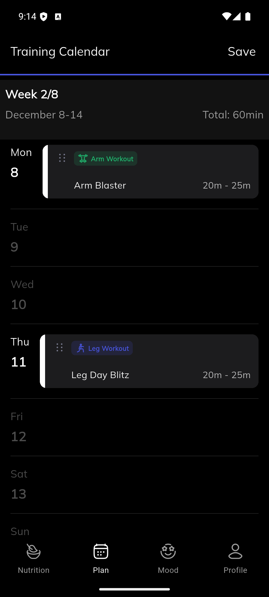
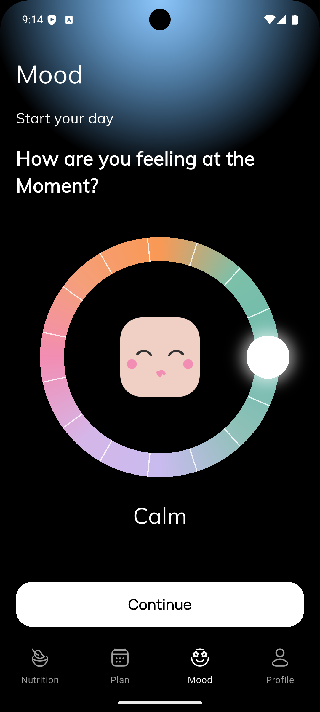
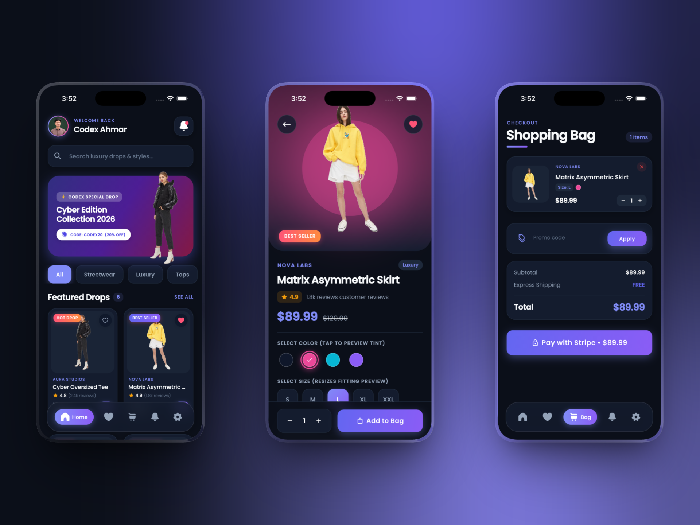

# Flutter UI Projects

A curated showcase of handcrafted **Flutter UI concepts, micro-interactions, and interactive product flows** built to explore mobile design craft and share on social media (TikTok, Instagram Reels, and LinkedIn).

## Projects at a Glance

| Project | Highlights | Source Code | Docs |
| :--- | :--- | :--- | :--- |
| **Crave — Food Delivery** | 3-color editorial UI, animated splash, auto-slider, cached shimmer images & street-locked live courier map | [Browse Code](./Food%20Delivery/lib) | [README](./Food%20Delivery/README.md) |
| **Ride Tracking UI** | Dark Midnight Slate vector street map, multi-stop route booking, pickup PIN flow & custom snackbar | [Browse Code](./Ride%20Tracking%20UI/lib) | [README](./Ride%20Tracking%20UI/README.md) |
| **Onboarding UI** | Scroll-driven `PageView` parallax, swipe rim light, rolling step odometer & morphing progress CTA | [Browse Code](./Onboarding/lib) | [README](./Onboarding/README.md) |
| **Pinterest UI Clone** | Two-column staggered masonry wall, shimmer loading skeletons, Hero pin viewer & tab navigation | [Browse Code](./Pinterest%20UI/lib) | [README](./Pinterest%20UI/README.md) |
| **Furniture Marketplace UI** | Architectural Dribbble-inspired concept, fluid Hero flights, tactile micro-interactions & floating nav bar | [Browse Code](./Furniture%20Marketplace/lib) | [README](./Furniture%20Marketplace/README.md) |
| **Solaris — Solar System 3D** | Interactive 3D planetary globe, Cupertino & Material 3 adaptive UI, flight paths & waypoints | [Browse Code](./Solar%20System%203D/lib) | [README](./Solar%20System%203D/README.md) |
| **AuraFit — Fitness UI** | Hydration wave chart (`fl_chart`), training plans, 360° mood dial & custom calendar routines | [Browse Code](./AuraFit/lib) | [README](./AuraFit/README.md) |
| **CryptoVista — Portfolio UI** | Web3 glassmorphic bottom nav, wallet visibility toggle, Light/Dark/System modes & analytics cards | [Browse Code](./Crypto%20Portfolio/lib) | [README](./Crypto%20Portfolio/README.md) |
| **StripeCart — Luxury Shop** | Cyber-luxury e-commerce UI, live color-swatch tinting, frosted nav, promo engine & Stripe checkout | [Browse Code](./StripeCart/lib) | [README](./StripeCart/README.md) |
| **Asma-ul-Husna UI** | Synchronized Arabic/Urdu 99 Names player with `just_audio_background` & staggered splash | [Browse Code](./Asma%20Ul%20Husna/lib) | [README](./Asma%20Ul%20Husna/README.md) |

---

## Showcase

### 1. [Crave — Food Delivery UI](./Food%20Delivery/lib)

A light-mode food delivery UI built around **Warm Ivory**, **Deep Espresso**, and **Terracotta Ember**, pairing `Plus Jakarta Sans` typography and `CupertinoIcons` with a street-locked `CustomPainter` delivery tracker.


- **Animated Brand Splash & Cached Shimmers**: Smooth logo/wordmark launch choreography (`SplashScreen`) and skeleton shimmer placeholders (`FoodNetworkImage`).
- **Discovery & Checkout**: Auto-sliding featured kitchens, category filtering, empty-by-default bag counter badge, and interactive door-handoff & extras checkout (`OrderConfirmationScreen`).
- **Street-Locked Courier Route**: Top-down motorcycle (`DeliveryScooterMarker`) pulses while waiting at the restaurant, follows street centerlines via `PathMetric`, and triggers an arrival banner notification.

**[Explore Food Delivery Code →](./Food%20Delivery/lib)** · **[Full Project README](./Food%20Delivery/README.md)**

---

### 2. [Ride Tracking UI](./Ride%20Tracking%20UI/lib)

An interactive dark-mode ride-booking and live trip tracking experience built around a **Midnight Slate** & **Sky Azure** palette and a tappable vector street map.


- **Interactive Vector Map**: Street-aligned shortest-path routing with named landmarks, ambient traffic, and vehicle approach/departure animations.
- **Complete Rider Journey**: `Book a ride` → stop selection → driver match preview → pickup arrival (`PIN 4920`) → trip completion & rating (`RideSnackbar`).

**[Explore Ride Tracking Code →](./Ride%20Tracking%20UI/lib)** · **[Full Project README](./Ride%20Tracking%20UI/README.md)**

---

### 3. [Onboarding UI](./Onboarding/lib)

A dark-mode Flutter onboarding flow driven by continuous scroll physics, studio rim lighting, and stateful micro-animations.


- **Scroll-Driven Parallax & Lighting**: Real-time `PageView` depth offsets, subtle 3D Y-tilt, background palette interpolation, and swipe-tracked top-edge rim lighting (`StudioRimLight`).
- **Morphing Action CTA**: Clipped vertical-rolling step odometer paired with a custom-painted radial progress ring (`ProgressNextButton`) expanding into a completion pill.

**[Explore Onboarding Code →](./Onboarding/lib)** · **[Full Project README](./Onboarding/README.md)**

---

### 4. [Pinterest UI Clone](./Pinterest%20UI/lib)

A crisp Flutter recreation of the Pinterest mobile interface featuring two-column staggered masonry walls and seamless detail transitions.


- **Masonry Wall & Hero Viewer**: Pull-to-refresh pin wall, shimmer loading placeholders, and Hero image transitions into creator details and recommendations.

**[Explore Pinterest UI Code →](./Pinterest%20UI/lib)** · **[Full Project README](./Pinterest%20UI/README.md)**

---

### 5. [Furniture Marketplace UI](./Furniture%20Marketplace/lib)

A modern, minimal Flutter e-commerce UI concept for an architectural furniture marketplace, inspired by Dribbble trends with clean typography and editorial product presentation.


- **Editorial & Tactile Interactions**: Fluid Hero product transitions, animated CTA micro-interactions, top in-app notification banner, architectural typography, and a floating navigation bar.

**[Explore Furniture Marketplace Code →](./Furniture%20Marketplace/lib)** · **[Full Project README](./Furniture%20Marketplace/README.md)**

---

### 6. [Solaris — Solar System 3D](./Solar%20System%203D/lib)

An interactive 3D solar system and planetary encyclopedia powered by `flutter_earth_globe`, featuring platform-native **Apple Cupertino** (iOS) and **Material 3** (Android) interfaces.

- **3D Globe & Waypoints**: 360° celestial textures across the Solar System, animated sub-orbital trajectory arcs, real-time ground coordinates, and adaptive multi-pane tablet/desktop layouts.

**[Explore Solar System 3D Code →](./Solar%20System%203D/lib)** · **[Full Project README](./Solar%20System%203D/README.md)**

---

### 7. [AuraFit — Smart Fitness & Wellness Tracker](./AuraFit/lib)

A responsive fitness and wellness UI combining structured workout scheduling, dynamic hydration & calorie tracking, and mindful mood logging.

<p>
  
  
  
</p>

- **Data Viz & Custom Controls**: Interactive `fl_chart` fluid hydration wave, `table_calendar` routine picker, drag-and-drop workout plans, and a 360° custom-painted mood dial.

**[Explore AuraFit Code →](./AuraFit/lib)** · **[Full Project README](./AuraFit/README.md)**

---

### 8. [CryptoVista — Crypto Portfolio UI](./Crypto%20Portfolio/lib)

A Flutter crypto-wallet showcase focused on clean UI architecture, adaptive `Light` / `Dark` / `System` theming, and staged screen transitions.

- **Web3 Wallet Experience**: Glassmorphic `Web3BottomNavBar`, balance visibility toggle, quick address copy, analytics cards, and responsive dashboard layouts.

**[Explore Crypto Portfolio Code →](./Crypto%20Portfolio/lib)** · **[Full Project README](./Crypto%20Portfolio/README.md)**

---

### 9. [StripeCart — Luxury E-Commerce UI](./StripeCart/lib)

An editorial luxury shopping app built with Flutter & GetX featuring cyber-luxury dark/light palettes, frosted glass navigation, and Stripe PaymentSheet checkout.



- **Interactive Showcase & Checkout**: Dynamic color-swatch background tinting, size-scaling fitting preview, promo code engine (`CODEX20`), wishlist, and `flutter_stripe` PaymentSheet integration.

**[Explore StripeCart Code →](./StripeCart/lib)** · **[Full Project README](./StripeCart/README.md)**

---

### 10. [Asma-ul-Husna UI (99 Names of Allah)](./Asma%20Ul%20Husna/lib)

A spiritual Flutter UI pairing Arabic & Urdu calligraphy (`Amiri`, `Noto Nastaliq Urdu`, `Poppins`) with synchronized audio recitation and lock-screen playback.

- **Audio & Staggered Motion**: Real-time name/timing sync via `just_audio` & `just_audio_background`, tap-to-skip navigation, and custom staggered splash entrance animations.

**[Explore Asma-ul-Husna Code →](./Asma%20Ul%20Husna/lib)** · **[Full Project README](./Asma%20Ul%20Husna/README.md)**

---

## Running Any Project

Each folder is a standalone Flutter application:

```bash
cd "<project-folder>"
flutter pub get
flutter run
```

