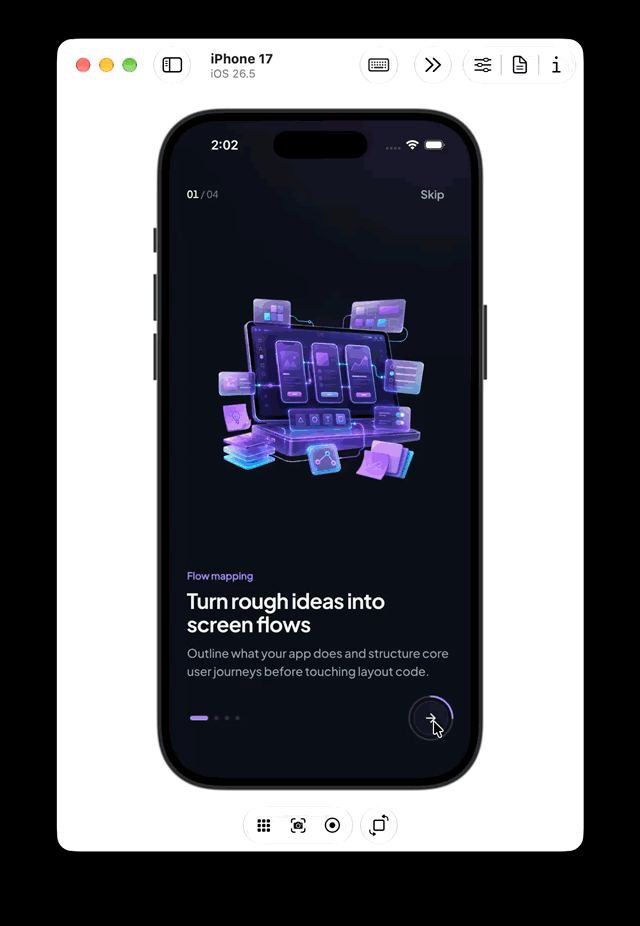

# Flutter UI Projects

A curated showcase of handcrafted **Flutter UI concepts, micro-interactions, and interactive product flows** built to explore mobile design craft and share on social media (TikTok, Instagram Reels, and LinkedIn).

## Projects at a Glance

| Project | Highlights | Source Code | Docs |
| :--- | :--- | :--- | :--- |
| **Crave — Food Delivery** | 3-color editorial UI, animated splash, auto-slider, cached shimmer images & street-locked live courier map | [Browse Code](./Food%20Delivery/lib) | [README](./Food%20Delivery/README.md) |
| **Ride Tracking UI** | Dark Midnight Slate vector street map, multi-stop route booking, pickup PIN flow & custom snackbar | [Browse Code](./Ride%20Tracking%20UI/lib) | [README](./Ride%20Tracking%20UI/README.md) |
| **Onboarding UI** | Scroll-driven `PageView` parallax, swipe rim light, rolling step odometer & morphing progress CTA | [Browse Code](./Onboarding/lib) | [README](./Onboarding/README.md) |
| **Pinterest UI Clone** | Two-column staggered masonry wall, shimmer loading skeletons, Hero pin viewer & tab navigation | [Browse Code](./Pinterest%20UI/lib) | [README](./Pinterest%20UI/README.md) |

---

## Showcase

### 1. [Crave — Food Delivery UI](./Food%20Delivery/lib)

A light-mode food delivery UI built around **Warm Ivory**, **Deep Espresso**, and **Terracotta Ember**, pairing `Plus Jakarta Sans` typography and `CupertinoIcons` with a street-locked `CustomPainter` delivery tracker.


- **Animated Brand Splash & Cached Shimmers**: Smooth logo/wordmark launch choreography (`SplashScreen`) and skeleton shimmer placeholders (`FoodNetworkImage`).
- **Discovery & Checkout**: Auto-sliding featured kitchens, category filtering, empty-by-default bag counter badge, and interactive door-handoff & extras checkout (`OrderConfirmationScreen`).
- **Street-Locked Courier Route**: Top-down motorcycle (`DeliveryScooterMarker`) pulses while waiting at the restaurant, follows street centerlines via `PathMetric`, and triggers an arrival banner notification.

**[Explore Food Delivery Code →](./Food%20Delivery/lib)** · **[Full Project README](./Food%20Delivery/README.md)**

---

### 2. [Ride Tracking UI](./Ride%20Tracking%20UI/lib)

An interactive dark-mode ride-booking and live trip tracking experience built around a **Midnight Slate** & **Sky Azure** palette and a tappable vector street map.


- **Interactive Vector Map**: Street-aligned shortest-path routing with named landmarks, ambient traffic, and vehicle approach/departure animations.
- **Complete Rider Journey**: `Book a ride` → stop selection → driver match preview → pickup arrival (`PIN 4920`) → trip completion & rating (`RideSnackbar`).

**[Explore Ride Tracking Code →](./Ride%20Tracking%20UI/lib)** · **[Full Project README](./Ride%20Tracking%20UI/README.md)**

---

### 3. [Onboarding UI](./Onboarding/lib)

A dark-mode Flutter onboarding flow driven by continuous scroll physics, studio rim lighting, and stateful micro-animations.



- **Scroll-Driven Parallax & Lighting**: Real-time `PageView` depth offsets, subtle 3D Y-tilt, background palette interpolation, and swipe-tracked top-edge rim lighting (`StudioRimLight`).
- **Morphing Action CTA**: Clipped vertical-rolling step odometer paired with a custom-painted radial progress ring (`ProgressNextButton`) expanding into a completion pill.

**[Explore Onboarding Code →](./Onboarding/lib)** · **[Full Project README](./Onboarding/README.md)**

---

### 4. [Pinterest UI Clone](./Pinterest%20UI/lib)

A crisp Flutter recreation of the Pinterest mobile interface featuring two-column staggered masonry walls and seamless detail transitions.


- **Masonry Wall & Hero Viewer**: Pull-to-refresh pin wall, shimmer loading placeholders, and Hero image transitions into creator details and recommendations.

**[Explore Pinterest UI Code →](./Pinterest%20UI/lib)** · **[Full Project README](./Pinterest%20UI/README.md)**

---

## Running Any Project

Each folder is a standalone Flutter application:

```bash
cd "<project-folder>"
flutter pub get
flutter run
```

