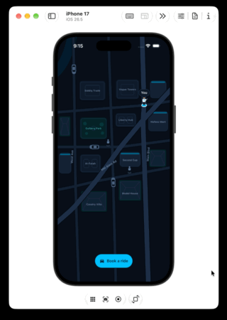

# Ride Tracking UI

An interactive dark-mode Flutter ride-booking and live trip tracking UI built around a Midnight Slate + Sky Azure palette and a custom vector street map.

## Demo



## Highlights

- **Interactive Vector Map**: Street-aligned shortest-path routing with tappable named places (buildings, shops, houses, park), ambient traffic, and driver approach/departure animations.
- **Full Rider Flow**: `Book a ride` entry CTA → stop selection → driver match preview → `Book ride` confirmation → pickup arrival (`PIN 4920`) → boarding & drop-off → rating or skip back to `Book a ride`.
- **Step Progress & Custom Snackbar**: State-aware two-stop indicator (`RouteStepIndicator`) and top notification-style snackbar (`RideSnackbar`).

## Quick Start

```bash
flutter pub get
flutter run
flutter test
```
